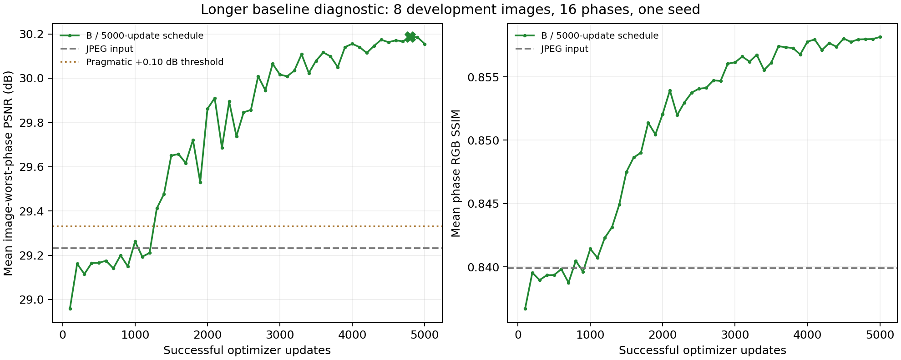
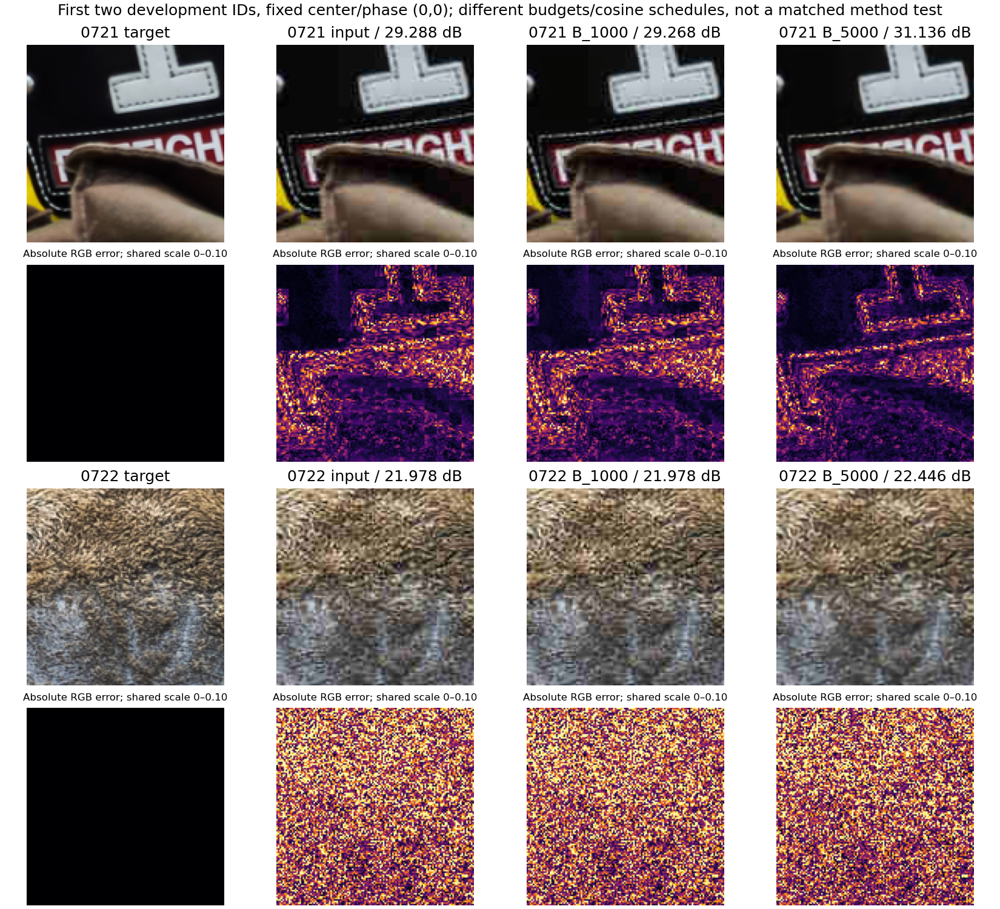

# Longer baseline diagnostic — completed and verified

The separately approved **5,000-update** stratified pixel-only baseline completed on local MPS in **89.12 minutes**, below its 100-minute soft cap, with **zero skipped updates and $0 spending**. The selected update is **4,800**. It improves development worst-phase PSNR by **0.955 dB** over JPEG input and ordinary full-image PSNR by **0.858 dB**. The predeclared continuation threshold passed.

This establishes a useful baseline in this project protocol. It **does not establish a novel method**, isolate training duration from learning-rate scheduling, or demonstrate the consistency candidate's benefit at the longer budget. Protected test remains unscored.

## Contract and evidence

The user explicitly approved “Approve baseline diagnostic.” [Exact config/approval](proposals/baseline_learning_v1/proposal.json), [preserved resolved config](studies/baseline_learning_v1/resolved_config.yaml), [summary and per-image values](studies/baseline_learning_v1/summary.json), [post-run verification](studies/baseline_learning_v1/postprocess.json).

- Same approved DnCNN-style RGB model: depth 20, width 64, BN, 669,379 parameters, scratch seed 42, L1, zero perceptual/consistency weight. No pipeline source changes or downloaded weights.
- Same 32 train / eight selection-development sources, Q20 RGB 4:4:4, aligned two-view stratified construction, target 128, clean batch 2, accumulation 4, MPS FP32. Totals: **40,000 clean crops, 80,000 degraded views, 20,000 microsteps**. BN sees four views per forward, not the accumulated effective batch.
- New 5,000-update warmup/cosine horizon, AdamW learning rate 2e-4 to 1e-6, warmup 100, clip norm 1. All 50 scheduled development panels were recorded. Clipping occurred on 26 updates; none were skipped.
- Select only on the original eight development images / fixed 16-phase panel `{0,2,4,6}²`, highest mean per-image worst-phase PSNR, earliest tie. Final update 5,000 scores 30.154755 dB; the selected checkpoint at 4,800 scores **30.185873**, so the selected and latest weights must not be confused.
- Project float RGB, prediction clamp at scoring, no quantization, border 0, CPU float64 PSNR/SSIM. Worst phase is minimized within each image before averaging images. Full-image scores are a separate endpoint.

## Primary and full-image development results

| Endpoint | JPEG input | Selected B / 5,000-update schedule | Change |
|---|---:|---:|---:|
| Eight-image mean worst-phase PSNR | 29.230958 dB | 30.185873 dB | +0.954915 dB |
| Eight-image mean phase PSNR | 29.308121 dB | 30.280424 dB | +0.972303 dB |
| Eight-image mean phase SSIM | 0.839884 | 0.857976 | +0.018092 |
| Eight-image full-image PSNR | 31.281650 dB | 32.139600 dB | +0.857950 dB |
| Eight-image full-image SSIM | 0.853382 | 0.871765 | +0.018383 |

All eight primary images improve in worst-phase PSNR; per-image gains range **+0.350561 to +1.885201 dB**. [Per-image CSV](studies/baseline_learning_v1/per_image.csv), [phase report](studies/baseline_learning_v1/development.json), [full-image report](studies/baseline_learning_v1/full_image_development.json), [independently recomputed input reference](studies/baseline_learning_v1/jpeg_input_full_image_development.json).

The threshold was at least +0.10 dB worst-phase gain and no decrease in mean phase SSIM, conditional on completing all updates without nonfinite/skip/OOM failures. It is an operational screening criterion, not a significance test or novelty certificate. Development selection remains optimistic; no paired confidence interval is promoted as held-out evidence.

[Exact validation-curve CSV](studies/baseline_learning_v1/validation_curve.csv). The curve shows useful learning after the weak 1,000-update stage and smaller late changes. It does not prove convergence. The first 100 warmup updates exactly replay the earlier B losses, learning rates, gradient norms and development endpoint in this fixed environment; schedules differ afterward. [Warmup evidence](studies/baseline_learning_v1/warmup_replay.json).

## Supplementary development sources unused for selection

After observing interim primary improvement, a bounded supplementary check was prepared on the remaining **72 development IDs 0729–0800**. These are existing DIV2K training-archive sources in the approved project's development split, disjoint from the 32 training and eight selection sources. No protected-test image was scored. The checkpoint was still selected solely on the original eight sources; supplementary outcomes did not change it.

| Endpoint, 72 images / 16 phases | JPEG input | Selected B |
|---|---:|---:|
| Mean per-image worst-phase PSNR | 29.032815 dB | 29.914286 dB |
| Mean phase SSIM | 0.832324 | 0.853130 |

Worst-phase gain: **+0.881471 dB**. This is supplementary development evidence, prepared after interim improvement, **not preregistered confirmatory testing**. [Declared supplementary scope](studies/baseline_learning_v1/supplementary_plan.json), [immutable subset manifest](studies/baseline_learning_v1/unselected_development72.jsonl), [complete report](studies/baseline_learning_v1/supplementary_development72.json), [independent aggregation summary](studies/baseline_learning_v1/supplementary_summary.json).

## Verification and qualitative review

Saved selected checkpoint/log replay agrees; independent per-image aggregation agrees; all pipeline source hashes match the approved proposal and prior 47-test acceptance. [Verification log](studies/baseline_learning_v1/postprocess.json) retains actual commands, exit codes and outputs. A deliberately unmatched 1,000-versus-5,000-update comparison was correctly rejected by the shared comparison CLI, with no invalid result file written. [Guard evidence](studies/baseline_learning_v1/budget_guard_verification.json).

The trained inference CLI exactly matches direct inference after PNG export: maximum byte difference **0**. [CLI check](studies/baseline_learning_v1/trained_cli_verification.json). CPU/MPS engineering acceptance remains applicable because the frozen pipeline did not change; it reports 47 tests/zero skips, not a newly invented test count. CUDA remains hardware-unverified.

The first two development IDs, fixed center and phase (0,0), were used without quality-based selection. Both budgets are inferred in float on the same device; error maps share scale 0–0.10. Display exports are 8-bit. Better reconstruction is visible in these examples, while fine texture remains imperfect. [Figure identities and scores](studies/baseline_learning_v1/qualitative_metadata.json).

## Checkpoint and next research gate

Selected local checkpoint: `experiments/studies/baseline_learning_v1/B_seed42/best_model.pth`.

SHA256: `db32a6373fad66a5d2e86bc6b2cc00ffc8e9935bad3aeb8b8e42ff553c0bdcb9`.

Latest checkpoint SHA256: `934cf1464a3b8a8e8ae3a29169837f2d6f9793604bdd8f0cce8b2eb133bf831e`.

The prior matched A/B/C 1,000-update negative finding remains valid **at that budget**. It does not establish whether C helps after useful baseline learning. A defensible next stage would match A and C to this exact 5,000-update B recipe before any longer-budget candidate claim, then assess seeds and prior-art differentiation. Additional long runs, downloads or protected testing are **not authorized** by this completed diagnostic. The new-method/publishable-novelty requirement remains unresolved. [Research checkpoint/handoff](../docs/architecture/research_checkpoint.md), [limitations](limitations.md).
