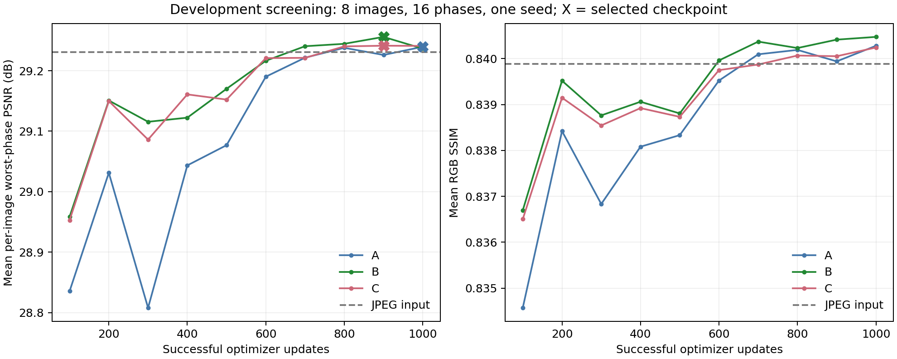
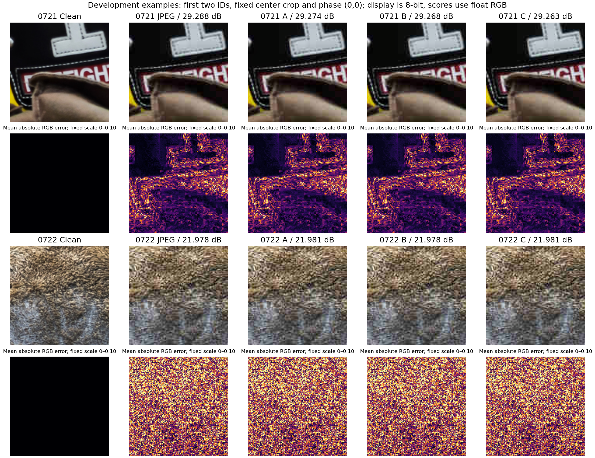

# JPEG phase screening results — 2026-10-21

Follow-up: the separately approved [5,000-update B diagnostic](baseline_diagnostic.md) is complete and shows useful baseline learning (+0.955 dB primary-development worst-phase PSNR). It uses a different update/cosine horizon and must not be substituted into this matched 1,000-update table. Longer-budget A/C and novelty remain unresolved.

The approved screening completed: **3,000 successful updates in 56.44 minutes**, $0 spending, zero skipped updates, no protected-test scoring. The added consistency loss **did not improve on stratification alone**. All learned models remain close to JPEG input quality. This is an exploratory development result, not a validated novel method or benchmark reproduction.

Evidence: [summary JSON](studies/mps_screening_v1/summary.json), [CSV](studies/mps_screening_v1/summary.csv), [checkpoint/source integrity](studies/mps_screening_v1/integrity.json), [model card](studies/mps_screening_v1/model_card.md) and [experiment ledger](experiments.md).

## Matched protocol

- DIV2K project screening: training IDs 0001–0032; development IDs 0721–0728. Protected IDs 0801–0816 remain unscored. These results do not cover the larger 720/80/100 manifests.
- Unchanged DnCNN-style RGB residual model: 20 convolutions, width 64, BatchNorm, 669,379 parameters, scratch initialization, seed 42. L1 project variant, not an exact paper reproduction.
- Each arm: 1,000 successful AdamW updates, FP32 MPS, target patch 128, clean microbatch 2, accumulation 4, two views per crop: 8,000 clean crops / 16,000 degraded views. BN sees four views per forward. Identical clean crops, initialization, augmentation, schedule and horizon.
- JPEG: Pillow 12.2.0, reported JPEG library 9.0, RGB 4:4:4, Q20, optimize/progressive false. `jpeg_aligned_phase_v1` compresses identical target content under two block origins; no wraparound shifts.
- A=random phase/pixel loss; B=stratified phase/pixel loss; C=same stratification plus 0.05 output L1 agreement with gradients through both branches.
- Selection every 100 updates: highest development mean per-image worst-phase PSNR on fixed panel `{0,2,4,6}²`, earliest tie. Scores below replay the **selected best checkpoints**, not necessarily the final update.
- Metrics: clamp float RGB to [0,1], no quantization, border 0, per-image PSNR average, CPU float64 PSNR/valid-window Gaussian SSIM. Phase endpoint uses a fixed center 128-pixel target. Full-image evaluation is separate. [Protocol contracts](../docs/architecture/approved_design.md), [commands](../docs/runbook.md).

## Primary development endpoint

Eight images, 16 phases per image. “Worst” means minimum phase PSNR within each image, then mean across images. JPEG input uses identical targets/phases.

| Arm | Selected update | Mean image-worst PSNR (dB) | Gain over JPEG (dB) | Mean phase PSNR (dB) | Mean phase SSIM | Training minutes |
|---|---:|---:|---:|---:|---:|---:|
| JPEG input | — | 29.230958 | — | 29.308121 | 0.839884 | — |
| A random / pixel | 1000 | 29.239696 | +0.008738 | 29.318287 | 0.840278 | 18.56 |
| B stratified / pixel | 900 | 29.256013 | +0.025055 | 29.331174 | 0.840412 | 19.14 |
| C stratified / consistency | 900 | 29.241428 | +0.010471 | 29.318132 | 0.840051 | 18.74 |

Exact reports: [A](studies/mps_screening_v1/A_dev.json), [B](studies/mps_screening_v1/B_dev.json), [C](studies/mps_screening_v1/C_dev.json). Selected scores match training logs and independent aggregation; pipeline fingerprints are identical across arms and current source. Best/latest hashes remain in the integrity report. B/C completion summaries contain **last-update** scores and must not replace this table.

| Paired development comparison | Mean difference (dB) | Descriptive image-bootstrap 95% interval (dB) |
|---|---:|---:|
| B minus A | +0.016317 | [+0.008830, +0.024657] |
| C minus A | +0.001733 | [−0.009027, +0.011334] |
| C minus B | −0.014584 | [−0.026387, −0.003335] |

10,000 bootstrap replicates, seed 42, sampling whole images after averaging paired training-seed deltas; only one training seed exists. **Intervals reuse checkpoint-selection development data and are descriptive.** They do not estimate held-out generalization, establish seed robustness or prove publishable superiority. [B−A](studies/mps_screening_v1/B_minus_A_dev.json), [C−A](studies/mps_screening_v1/C_minus_A_dev.json), [C−B](studies/mps_screening_v1/C_minus_B_dev.json).

Curves show recovery from poor early predictions toward input quality; convergence is not established. Selected updates follow the predeclared development rule; no test selection occurred.

## Separate full-image development check

Same eight development sources, ordinary full-source Q20 compression, one full-image pass. This does not sweep origins and must not be pooled with the patch endpoint.

| Model | Mean PSNR (dB) | Gain over JPEG (dB) | Mean SSIM |
|---|---:|---:|---:|
| JPEG input | 31.281650 | — | 0.853382 |
| A selected | 31.286015 | +0.004364 | 0.854019 |
| B selected | 31.294960 | +0.013309 | 0.853856 |
| C selected | 31.293056 | +0.011406 | 0.853800 |

Reports: [input](studies/mps_screening_v1/jpeg_input_full_image_dev.json), [A](studies/mps_screening_v1/A_full_image_dev.json), [B](studies/mps_screening_v1/B_full_image_dev.json), [C](studies/mps_screening_v1/C_full_image_dev.json). Gains remain very small and do not support a practically strong restoration claim.

## Failure investigation and integration

[Diagnostics](studies/mps_screening_v1/diagnostics.json) found changed weights (parameter L2 changes 1.09–1.13), but predicted residual RMS only 0.00220–0.00267 versus target residual RMS 0.03765. With an additional **diagnostic-only** 20-pixel border crop, input worst-phase PSNR is 29.556214 dB and A/B/C are 29.605125/29.616806/29.587091. Interior gains remain below 0.061 dB; padding alone does not explain the weak result. This does not replace the primary border-0 endpoint.

A bounded [fixed-patch learning check](studies/mps_screening_v1/fixed_patch_qa.json) completed 200 updates in 17.11 seconds using only original training sources 0001/0002 and a different diagnostic learning rate. It is not a fourth research arm. Train-patch PSNR rose from 25.874034 to 28.294903 dB versus JPEG input 28.270588. [Independent inspection](studies/mps_screening_v1/optimization_path_qa.json) found finite nonzero gradients in all 58 parameter tensors and nearly identical train/eval-mode scores. The path learns; this short check does not demonstrate strong overfitting, identify a definitive cause or establish convergence. Duration, initialization, optimization and objective suitability remain questions.

[Trained inference CLI](studies/mps_screening_v1/trained_cli_verification.json) passed: image 0721 produces RGB 128x128 output exactly matching direct inference after PNG export (maximum byte difference 0). This verifies saved-model deployment, not scientific benefit.

Examples are the first two development IDs, fixed phase (0,0), without searching for favorable images. Error scale is absolute RGB 0–0.10. Display is 8-bit; scores use float RGB. Improvements are not reliably visible; individual images can worsen.

## Decision and limits

Do **not** expand C into the nine-run seed study solely on this 1,000-update evidence. The follow-up now establishes useful baseline learning under its longer recipe, so the next research gate is a separately approved matched 5,000-update A/C comparison using that B, followed by prior-art/seed assessment. No longer-budget C benefit or production/novel-method claim follows. [Research checkpoint](../docs/architecture/research_checkpoint.md).

Missing: multiple training seeds, protected-test/all-64-phase scores, Q10/Q40 mismatch, full-split coverage, verified transformer/pretrained comparators, official benchmark protocols, LPIPS and actual CUDA feasibility. No paper numbers, profiling losses or procedural scores substitute for research. The academic new-method/publishable-novelty requirement is **unfulfilled**.
